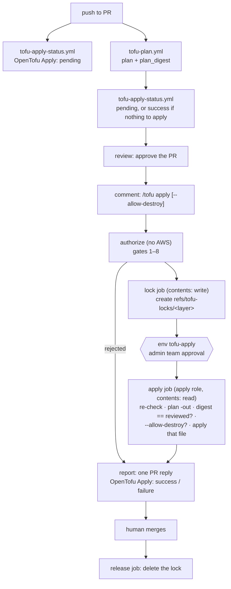

# OpenTofu pull-request apply

Apply-before-merge for the OpenTofu PR workflow, Atlantis-style. A maintainer comments
`/tofu apply` on a PR, CI applies the reviewed plan, and a human merges. `master` therefore only
receives code that is already live. This extends [`tofu-plan.md`](tofu-plan.md) and replaces the
unused Atlantis POC.

- Workflow: [`.github/workflows/tofu-apply.yml`](../../.github/workflows/tofu-apply.yml)
- Code: [`@bin/scripts/tofu_plan_ci/`](../../@bin/scripts/tofu_plan_ci/) (`apply_gates.py`,
  `apply_workflow.py`, `github_api.py`, `plan_digest.py`)
- AWS identity: [`apps-devstg/global/github-oidc-tofu-apply`](../../apps-devstg/global/github-oidc-tofu-apply/)
- Incident procedure: [`tofu-ci-incident.md`](tofu-ci-incident.md)

Status (2026-10-17): **active** on `apps-devstg/global/cli-test-layer`. All eight supervised cases
passed ([record](tofu-plan-history.md#apply-supervised-test)). The status is not required yet.

## 1. Decisions

| Topic | Decision |
| --- | --- |
| Model | Apply-before-merge. Merging is manual, after a successful apply |
| Trigger | PR comment `/tofu apply`. `issue_comment` runs the workflow and its tooling from `master` |
| What is applied | A fresh `plan -out` in the apply job, compared by digest with the reviewed plan; then `apply` of **that same file**. The binary never leaves the runner, so nothing can change between the comparison and the apply |
| Lock | Taken when `/tofu apply` passes the gates, and held until merge. Other PRs can still plan the layer, but cannot apply it |
| Lock storage | An annotated tag under `refs/tofu-locks/<layer-slug>`. Creating a ref is atomic, so two PRs cannot both take it |
| Write credentials | One apply role per account, least privilege: the union of the allowlisted layers, narrowed per job to one layer by a session policy |
| Delete / replace | Rejected unless the command is `/tofu apply --allow-destroy` |
| Approvers | The `leverage-ref-architecture-aws-admin` team, the only reviewer of the `tofu-apply` environment |
| Up to date | Strict: the head must contain the latest `master`. To be relaxed after the supervised test if it proves too costly |
| PR feedback | A 👀 reaction, then one reply with the outcome, counts, reasons, and the run link. No plan content |
| Merge gate | Required commit status `OpenTofu Apply` on the head commit, posted only by the `tofu-status` GitHub App (§5) |

## 2. Using it

1. **Author:** open the PR. It must touch exactly one layer that is allowlisted in both
   `TOFU_PLAN_LAYERS` and `TOFU_APPLY_LAYERS`. Keep the branch up to date with `master`.
2. **Reviewer:** read the diff and the plan run, approve `tofu-plan`, then **approve the PR**.
   The approval must be on the current head commit.
3. **Anyone with write access:** comment `/tofu apply`, or `/tofu apply --allow-destroy` if the
   plan deletes or replaces.
4. **Admin team member:** approve the `tofu-apply` deployment. This runs the PR's code with write
   access to the layer, so check the diff, including providers, modules, and data sources.
5. **Author:** after `✅ Applied`, merge right away. Merging releases the lock.

`/tofu unlock` releases this PR's locks once the admin team approves it. It is meant for the
cases in §6. Any other `/tofu` verb, such as `/tofu plan`, is ignored by this workflow.

## 3. Flow

Jobs and their permissions:

| Job | Runs | Permissions |
| --- | --- | --- |
| `authorize` | trusted tooling | `contents: read`, `actions: read` (plan evidence), `pull-requests: write` (reaction) |
| `lock` | trusted tooling | `contents: write` (lock ref) |
| `apply` | **PR code** + trusted tooling, env `tofu-apply` | `contents: read`, `pull-requests: read`, `id-token: write` |
| `unlock` | trusted tooling, env `tofu-apply` | `contents: write` |
| `report` | trusted tooling, env `tofu-status` | `contents: write` (release an unused lock), `pull-requests: write`; the status goes out with the app's token |
| `release` (PR closed) | trusted tooling | `contents: write`, `pull-requests: write` |

## 4. Gates

`authorize` checks every gate before any lock or credential exists. The apply job re-checks the
gates marked ↻, because they can change while the run waits for approval:

1. The commenter has write, maintain, or admin access, and `TOFU_APPLY_LIVE` is `true`.
2. The PR is open, not a draft, from this repository, and opened by a user ↻.
3. The PR has an approval **on the current head commit** from someone other than the author, and
   no outstanding "changes requested" ↻. Pushing a new commit invalidates the approval ↻.
4. The head is up to date with `master` (`behind_by == 0`) ↻. Otherwise the apply would undo
   whatever `master` changed in the layer.
5. The latest `OpenTofu Plan` run for the head commit succeeded. It has exactly one live layer
   result, and that result has a `plan_digest`.
6. The layer is in `TOFU_APPLY_LAYERS`, and `TOFU_APPLY_ROLES` has an apply role for its account.
7. No other PR holds the layer's lock.
8. The plan has no delete or replace unless the command carried `--allow-destroy`. This is checked
   again on the fresh plan.
9. The fresh plan's digest equals the reviewed plan's digest (apply job).
10. A member of `leverage-ref-architecture-aws-admin` approves `tofu-apply`. GitHub enforces this
    together with Prevent self-review and the `master`-only branch policy; `GITHUB_TOKEN` cannot
    read team membership.

A PR that changes a workflow, the CI tooling, providers, or backends gets no live plan
([Limitations](tofu-plan.md#limitations)), so gate 5 rejects it. Those changes are applied
manually.

## 5. The `OpenTofu Apply` status

Branch protection requires `OpenTofu Apply` on the head commit, and counts it only when the
`tofu-status` GitHub App posted it. Two workflows post it, both from `master`:

| Posted by | When | State |
| --- | --- | --- |
| `tofu-apply-status.yml`, PR event | No onboarded layer changed (from the PR files API) | success |
| `tofu-apply-status.yml`, PR event | The PR changes the plan tooling: it gets no live plan | success: "apply it manually" |
| `tofu-apply-status.yml`, PR event | Otherwise, while the plan runs | pending |
| `tofu-apply-status.yml`, plan finished | The onboarded layer has changes | pending: "comment /tofu apply after review" |
| `tofu-apply-status.yml`, plan finished | No changes, no live plan, or a layer that is not onboarded | success, with the reason |
| `tofu-apply-status.yml`, plan finished | The plan failed, or its evidence is missing | pending |
| `tofu-apply.yml` report | Applied, or nothing to apply | success |
| `tofu-apply.yml` report | The apply failed | failure |

A rejected command leaves the status unchanged. The PR event never replaces a status the app
already set on that commit. A plan run is read only if it is the latest `tofu-plan.yml` run for
the head commit, and the PR is not a draft.

Success needs positive evidence. "No live plan" counts only when the run was skipped, when
discovery left the layer out, or when the layer has the validation result that discovery and
`TOFU_PLAN_LIVE` call for. A failed artifact download or a missing result keeps the status
pending.

**Why an app.** Any workflow on any branch can post a commit status as `github-actions`, and a PR
can add or edit workflows, so a status from `GITHUB_TOKEN` proves nothing. The app's private key
is a secret of the `tofu-status` environment, whose branch policy admits only `master`. Jobs
from a PR (`pull_request`, a push to a branch, or `workflow_dispatch` on a branch) cannot read it.
`pull_request_target`, `workflow_run` and `issue_comment` run the default branch's file. A
`github-actions` status named `OpenTofu Apply` can still appear on a PR, but it does not satisfy
the rule.

**What it still trusts.** The plan evidence comes from the PR's plan run, which ran the PR's
OpenTofu code. A malicious data source could rewrite that evidence. That run needs the
`tofu-plan` approval, so the reviewer who approves it is the safeguard, as for the plan role.
A PR that changes the plan tooling is decided from the file list, without reading its run.

**Limits.** A PR from a fork or a bot gets no live plan, so it gets "no live plan: apply it
manually" when the plan run ends. A PR touching more than 3000 files is treated as touching every
onboarded layer.

## 6. Lock and failure modes

| Case | Behaviour |
| --- | --- |
| Applied, then merged | The `release` job deletes the lock |
| The run applied nothing (rejected at re-check, digest mismatch, no changes, approval rejected, failure before the apply step) | The lock is released, **only if this run took it** |
| Apply failed partway | The lock is kept and `OpenTofu Apply` is red. Fix forward or revert, then `/tofu apply` again. Never merge red |
| New commits after an apply | The new head is pending. Wait for its plan, approve again, then `/tofu apply`. Only the delta is applied |
| `master` moved | Gate 4 rejects. Update the branch, wait for the plan, then apply |
| Digest mismatch (drift, a stale plan, a changed value) | Rejected. Re-run or push to plan again, review, then apply |
| Closed without merging after an apply | The lock is **kept** and the workflow comments. Reopen, revert, `/tofu apply`, then `/tofu unlock` |
| Credential compromise | [`tofu-ci-incident.md`](tofu-ci-incident.md) |

The lock is an annotated tag whose message records the PR, the layer, the head commit, and the
run. Inspect it with `git ls-remote origin 'refs/tofu-locks/*'`.

## 7. Configuration

| Kind | Name | Value |
| --- | --- | --- |
| Variable | `TOFU_APPLY_LIVE` | `true` to accept applies. Kill switch: `false` rejects new commands. A run reads it when it starts, so reject or cancel a run that is already waiting for approval |
| Variable | `TOFU_APPLY_LAYERS` | Allowlist, comma- or newline-separated. Each layer must also be in `TOFU_PLAN_LAYERS` |
| Variable | `TOFU_APPLY_ROLES` | JSON: account directory → `{role_arn, account_id}`, as `TOFU_PLAN_ROLES` |
| `tofu-apply` secret | `TOFU_PLAN_COMMON_TFVARS` | Same value as in `tofu-plan` |
| `tofu-apply` secret | `TOFU_PLAN_DIGEST_KEY` | **Same value as in `tofu-plan`**; otherwise every digest mismatches. Rotate both together |
| Environment | `tofu-apply` | Reviewer `leverage-ref-architecture-aws-admin`, Prevent self-review, no admin bypass, branch `master` |
| Variable | `TOFU_STATUS_APP_CLIENT_ID` | Client ID of the `tofu-status` GitHub App |
| `tofu-status` secret | `TOFU_STATUS_APP_PRIVATE_KEY` | The app's private key. Never a repository secret: any branch could read it |
| Environment | `tofu-status` | No reviewers, branch `master` only. Jobs use it with `deployment: false` |
| GitHub App | `tofu-status` | Repository permission Commit statuses: read and write, nothing else. Installed on this repository only; no webhook |
| Branch protection | `master` | Required check `OpenTofu Apply`, source: the `tofu-status` app |

## 8. Phases

| # | Work | Status |
| --- | --- | --- |
| 0 | Remove `atlantis.yaml` | ✅ #1244 |
| 1 | `plan_digest` in the plan result | ✅ #1245 |
| 2 | Incident and credential-revocation procedure | ✅ #1246, rehearsed |
| 3 | `github-oidc-tofu-apply` for apps-devstg, `tofu-apply` environment | ✅ #1247 |
| 4 | `tofu-apply.yml`, gates, lock, report, `OpenTofu Apply` status | ✅ #1248 |
| 5 | Supervised test on `cli-test-layer`: rejections, create, lock conflict, merge release, update, digest mismatch, destroy with and without the flag, close unmerged and unlock | ✅ #1249–#1253, [record](tofu-plan-history.md#apply-supervised-test) |
| 6 | Required `OpenTofu Apply` from the `tofu-status` app (up to date and dismiss stale approvals were already on). `OpenTofu Plan` is not required: it adds no apply guarantee and is forgeable | ✅ #1255, #1257, [record](tofu-plan-history.md#required-apply-status) |
| 7 | Onboard `management/global/sso` and more layers | 🔄 |
| Later | Scheduled drift detection. Cut human write access (break-glass role) so git is the only path | — |

## 9. Coexistence with PR #1101

PR #1101 (`terraform-plan.yml`) is a parallel alternative that another team member is still
developing. This work does not modify it. This workflow acts only on `/tofu apply` and
`/tofu unlock`, and ignores every other `/tofu` verb, so `/tofu plan` stays free for #1101. The
maintainers are coordinating the command names before #1101 merges.
