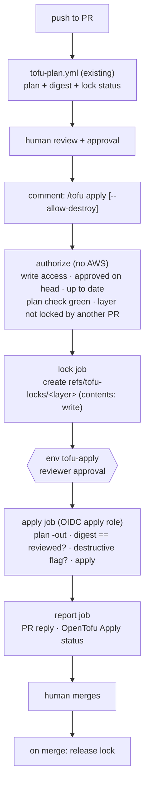

# OpenTofu pull-request apply (design, draft)

Status (2026-10-16): **design, not implemented.** Extends [`tofu-plan.md`](tofu-plan.md) from
plan-only to GitOps: the PR is applied **before** it is merged, Atlantis-style, so `master` only
ever receives code that is already live. Replaces the unused Atlantis POC (`atlantis.yaml`).

## 1. Decisions

| Topic | Decision |
| --- | --- |
| Model | Apply-before-merge. Merge is manual, after a successful apply |
| Trigger | PR comment `/tofu apply`, run by `issue_comment`, so the workflow and tooling come from `master` |
| What is applied | Fresh `plan -out` in the apply job, compared to the reviewed plan, then `apply` of **that same file**. The binary never leaves the runner, so the compare-to-apply window is zero |
| Lock | Taken at apply, held until merge. Other PRs can plan the layer meanwhile, but their apply is rejected |
| Write credentials | One apply role per account, **least privilege**: union of the allowlisted layers' write actions, narrowed per job by a session policy to that layer (same pattern as the plan roles) |
| Delete / replace | `/tofu apply` is rejected when the plan has delete or replace. `/tofu apply --allow-destroy` is required |
| PR feedback | Minimal comment: a reaction on the command, then one reply with status, counts, and the run link. No plan content |
| Merge gate | Required check `OpenTofu Apply` on the head SHA: green when the layer has no changes or that SHA was applied |
| Lock storage | Git ref (see §5) |
| Approvers | Only the `leverage-ref-architecture-aws-admin` team, as the sole required reviewer of the `tofu-apply` environment |
| Up to date | Strict: the head must contain the latest `master` (`behind_by == 0`). To be relaxed after the supervised test if it proves too costly |

## 2. Flow

## 3. Gates

The apply runs only when **all** hold. `authorize` checks them before any credential is minted,
and the apply job re-checks the ones that can change while it waits for approval:

1. The commenter has write or admin access.
2. The PR has an approving review **on the current head SHA**, from someone other than the author.
   Branch protection must dismiss stale approvals.
3. The head is up to date with `master` (`behind_by == 0`). Otherwise the apply would roll back
   whatever `master` changed in the layer.
4. `OpenTofu Plan` is green for that head SHA, with exactly one layer (`TOFU_PLAN_MAX_LAYERS` stays 1).
5. The layer is not locked by another PR.
6. The fresh plan's digest equals the reviewed plan's digest (see §4).
7. No delete or replace unless the command carried `--allow-destroy`.
8. The `tofu-apply` environment is approved by a member of `leverage-ref-architecture-aws-admin`.
   GitHub must have "prevent self-review" enabled and a deployment branch policy of `master` only.
   Team membership is enforced by GitHub at this step, not in `authorize`: `GITHUB_TOKEN`
   cannot read organization team membership.

## 4. Plan digest

`review.json` lists only addresses, actions, and attribute names, so it cannot detect a value
that changed between review and apply. The plan job will add `plan_digest` to `result.json`:
an HMAC-SHA256 over the normalized `resource_changes` (address, actions, before, after,
after_unknown, sorted), keyed with an environment secret. It is HMAC and not a plain hash
because the artifact is public, and a plain hash of a low-entropy value can be brute-forced.
The apply job computes the same digest on its own plan and refuses to apply if the two differ.

## 5. Lock

- **Storage:** a git ref `refs/tofu-locks/<layer-slug>` pointing at the PR head, created through
  the API (creation is atomic, so a race fails). It is written by a dedicated job with
  `contents: write`. The apply job, which runs PR code with AWS credentials, keeps `contents: read`.
- **Release:** a `pull_request: closed` workflow deletes the lock when the PR is **merged**.
- **Closed unmerged after an apply:** the lock is **kept**, because the infrastructure no longer
  matches `master`. The workflow comments to say so. The way out is to revert in the same PR,
  `/tofu apply`, and then `/tofu unlock`, which a maintainer runs as an explicit acknowledgement.
- Plans on other PRs still run and show `locked by #N` in their summary.

## 6. Failure modes

| Case | Behaviour |
| --- | --- |
| Apply fails partway | Lock held, `OpenTofu Apply` red. Fix forward with new commits and `/tofu apply`, or revert and `/tofu apply`. Never merge red |
| New commits after an apply | `OpenTofu Apply` goes pending on the new SHA. Re-plan, re-approve, `/tofu apply` (only the delta) |
| `master` moves while locked | Gate 3 rejects. Rebase, re-plan, re-apply |
| Digest mismatch (drift or a stale plan) | Rejected. Push or re-run the plan, review again |
| Credential compromise | Incident and revocation procedure (prerequisite, see §8) |

## 7. Identities

- New layer per account: `<account>/global/github-oidc-tofu-apply`, starting with apps-devstg and
  `cli-test-layer`. It reuses the existing OIDC provider.
- Trust: `repo:binbashar/le-tf-infra-aws:environment:tofu-apply` only.
- Permissions: the layer's create, update, delete, and tag actions, plus `s3:PutObject` on its state key and its lock.
  The permissions boundary denies changes to the role itself, its boundary, its trust, and the OIDC
  provider. A layer that manages IAM is admin-equivalent in practice, which must be recorded when
  onboarding it.
- Session policy per job, computed by the trusted tooling from `master`, as in `plan_identity.py`.

## 8. Phases

| # | Work | Exit criterion |
| --- | --- | --- |
| 0 | Remove `atlantis.yaml` | No Atlantis config left in the repo |
| 1 | Plan side: `plan_digest`, lock status in the summary, `OpenTofu Apply` reported on every PR (a required check must always post) | Merged, plan behaviour unchanged |
| 2 | Incident and credential-revocation procedure (roadmap item) | Documented and rehearsed |
| 3 | `github-oidc-tofu-apply` for apps-devstg, `tofu-apply` environment | Applied by a maintainer |
| 4 | `tofu-apply.yml`: parse → authorize → lock → apply → report; `tofu-unlock.yml` on close and `/tofu unlock` | Unit tests for the parser, gates, and digest |
| 5 | Supervised test on `cli-test-layer`: no-op, create, update, destroy with and without the flag, digest mismatch, lock conflict between two PRs, failed apply, close unmerged | Every case recorded in `tofu-plan-history.md` |
| 6 | Branch protection: required `OpenTofu Plan` + `OpenTofu Apply`, up to date, dismiss stale approvals | Enforced on `master` |
| 7 | Onboard `management/global/sso` and more layers | Per-layer runbook |
| Later | Scheduled drift detection; cut human write access (break-glass role) so git is the only path | — |

## 9. Coexistence with PR #1101

PR #1101 (`terraform-plan.yml`) is a parallel alternative that another team member is still
developing. This work must not modify it. Its workflow also reacts to `/tofu plan` and `/tf-plan`
comments. While it is unmerged that is harmless: `issue_comment` workflows run only from
`master`, so its comment handler never fires. The workflow is also disabled in Actions as a
temporary guard. **Before #1101 merges**, the command namespace has to be agreed with its author,
or one comment could trigger both workflows.
