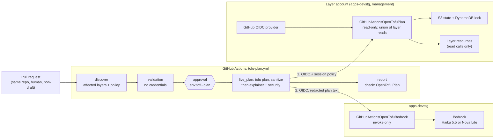

# OpenTofu pull-request plan

A GitHub Actions check that validates and plans OpenTofu changes on pull requests, with an
optional Bedrock explanation and security review. It never applies anything.

- Workflow: [`.github/workflows/tofu-plan.yml`](../../.github/workflows/tofu-plan.yml)
- Code: [`@bin/scripts/tofu_plan_ci/`](../../@bin/scripts/tofu_plan_ci/)
- AWS identities: [`apps-devstg/global/github-oidc-tofu-plan`](../../apps-devstg/global/github-oidc-tofu-plan/),
  [`management/global/github-oidc-tofu-plan`](../../management/global/github-oidc-tofu-plan/)
- History, gates, and decisions: [`tofu-plan-history.md`](tofu-plan-history.md)

## 1. What it is

For a PR that touches one allowlisted layer, the workflow:

1. validates the layer without credentials;
2. after a reviewer approves, runs a read-only `tofu plan` against the real state;
3. in the same job, sends the redacted plan text to Bedrock twice: an **explainer** says what the
   change does, a **security review** lists the risks it introduces;
4. publishes a sanitized summary, both analyses, and the `OpenTofu Plan` check.

Steps 2 and 3 are skipped for PRs that touch more layers than the limit or change the workflow,
providers, backends, or configuration (see [Limitations](#limitations)).

Status (2026-10-12): **active** on two layers, `apps-devstg/global/cli-test-layer` (test layer)
and `management/global/sso`. The check is not required.

## 2. Purpose

**Problem.** Reviewers judged infrastructure PRs by reading HCL, and the plan was generated
locally by the author and pasted by hand, which leaks identifiers easily and can go stale against
later commits.

**What it gives maintainers:**

- a plan for every commit, generated in CI from real state, not from the author's machine;
- a summary of actions per resource (create, update, delete, replace) and drift, with no values,
  so it is safe to keep in a public repository;
- an advisory explanation of what the change does, and an advisory security review with findings
  by severity;
- no new infrastructure to run: no Atlantis server, GitHub App, or webhook.

**Deliberately out of scope:** apply, destroy, import, any state change, PR comments, fork and
bot PRs, and planning layers outside the allowlist. Applying stays a manual maintainer step.

## 3. Using it

**PR author.** Open a non-draft PR from a branch in this repository. Nothing else is needed.

**Reviewer approving `tofu-plan`.** Approval runs the PR's exact commit with read access to that
layer's state and resources, and sends the redacted plan text to Bedrock. Approve only after
reading the diff: provider code, data sources, and modules in the PR execute during the plan.

**Reading the result.** Open the run's summary, or the artifacts:

| Artifact | Contents |
| --- | --- |
| `tofu-plan-layer-<layer>` | `summary.md` (actions table), `result.json` (status, counts), `review.json` (per-resource actions and changed attribute names, drift, check counts) |
| `tofu-plan-llm-<layer>` | `explainer.md` (summary and per-resource changes), `security.md` (overall risk and findings), and a status JSON for each with token counts |
| `tofu-plan-validation-<layer>`, `tofu-plan-discovery` | Credential-free validation and layer discovery |

Artifacts are kept for 7 days. The deterministic summary shows *which* attributes change, never
their values; the two analyses read the values and describe them. For the exact values, use the
author's local plan in the PR description: only the action section,
redacted and scanned with `@bin/scripts/redact_plan.py`, never a raw plan, saved plan file, or
`tofu show -json` output (procedure in [`CLAUDE.md`](../../CLAUDE.md#standard-workflow-posting-a-tofu-plan-to-a-pr-for-review)).

## 4. Architecture

### Diagram



### Components

| Component | Role |
| --- | --- |
| `discover` job | Maps changed files to layers (nearest `config.tf`), keeps only allowlisted active layers, and decides whether a live plan is allowed. Also runs the package's unit tests. |
| `validation` job | `tofu init -backend=false -lockfile=readonly` and `tofu validate` per layer. No credentials, no environment. |
| `live_plan` job | Environment `tofu-plan`. Assumes the account's plan role, runs `init`, `plan`, and `tofu show -json`, and keeps only the sanitized projection. It also writes the redacted action section of `tofu show` to a `0600` file and clears the plan credentials. Then it assumes the Bedrock role and runs the explainer and the security review; each answers through a forced, schema-bound tool call, is validated, and is masked and scanned before publishing. A final `always()` step deletes the plan text. |
| `report` job (`OpenTofu Plan`) | Aggregates all results into the stable check and the run summary. |
| `tofu_plan_ci` package | `discover.py` (layers), `policy.py` (live-plan eligibility), `plan_identity.py` (role and session policy), `plan_report.py` (sanitization), `plan_llm.py` (plan text, prompts, answer schemas, output masking), `bedrock_client.py` (reviewed models, forced tool call), `aggregate.py`, and `workflow.py` (one command per step). |
| `<account>/global/github-oidc-tofu-plan` | One per account with allowlisted layers: OIDC provider, plan role, and its policy, built from a `plan_targets` map plus one `plan-target-<layer>.tf` per layer. apps-devstg also holds the Bedrock role. |
| Environment `tofu-plan` | Required reviewer, Prevent self-review, no admin bypass. Holds the `TOFU_PLAN_COMMON_TFVARS` secret and the `BEDROCK_MODEL_ID` variable. |

### Interactions: one PR

```mermaid
sequenceDiagram
  autonumber
  actor Dev as Author
  participant GH as GitHub Actions
  actor Rev as Reviewer
  participant AWS as Layer account
  participant BR as Bedrock

  Dev->>GH: push commit
  GH->>GH: discover + validate (no credentials)
  GH-->>Rev: wait for approval (tofu-plan)
  Rev->>GH: approve
  GH->>AWS: OIDC token for env tofu-plan + session policy
  AWS-->>GH: 15-minute read-only credentials
  GH->>AWS: read state and layer resources (plan)
  GH->>GH: sanitize; keep redacted plan text; drop plan credentials
  GH->>BR: OIDC (same env) → invoke-only role; redacted plan text
  BR-->>GH: explainer answer, then security answer
  GH->>GH: mask + scan answers; delete plan text
  GH-->>Dev: check OpenTofu Plan + summary + analyses
```

A new commit cancels the in-progress run for that PR. Typical runner time is about 2 minutes per
layer, about 10 seconds of it in Bedrock; the rest is waiting for the approval.

### Key design points

- **Trust is bound to the environment.** Both roles accept only a GitHub token issued for the
  `tofu-plan` environment (`repo:binbashar/le-tf-infra-aws:environment:tofu-plan`), plus the
  repository and organization IDs and a PR merge ref or `master`. Approval is therefore required
  to get credentials, even if a PR edits the workflow.
- **Least privilege per layer.** The plan role holds the union of its layers' reads, derived from
  CloudTrail. Each job adds an inline session policy that narrows the state bucket and lock table
  to its own layer, so a plan of one layer cannot read another layer's state. State writes are
  explicitly denied.
- **Trusted tooling.** Sanitization, role resolution, and the Bedrock client run from the PR's
  base revision, not from the PR.
- **Control-plane changes never get credentials.** A PR that changes the workflow, its package,
  CODEOWNERS, provider locks, `config.tf`, `config/`, `<account>/config/`, JSON configuration,
  providers, backends, module or provider sources, external data sources, provisioners, or
  `null_resource`/`terraform_data` runs validation only.
- **Sanitized contract.** The persisted deterministic report has resource addresses (instance keys
  replaced), action classes, changed attribute names, drift, and counts. It never has values,
  variables, state, or the binary plan; account IDs, ARNs, and credential shapes are redacted.
- **What the model sees.** Only the action section of `tofu show`: sensitive values appear as
  `(sensitive value)`, unchanged attributes are hidden, and `redact_plan.py` removes account IDs,
  ARNs' account parts, and Identity Center IDs first, so the model cannot repeat them. Other values,
  including e-mail addresses, do reach Bedrock (accepted 2026-10-12; the sso e-mails are already in
  the public repository). Plans over an estimated 80K tokens are not sent.
- **What gets published.** Every answer is validated against its schema, e-mail addresses and
  credential shapes are masked, and the result is scanned again; an answer that still fails the
  scan is dropped.
- **The models cannot change the result.** The check depends only on the deterministic plan; a
  Bedrock failure is a warning. Plan content is passed as untrusted data, and the security review
  reports instructions found inside it as a finding.

### Limitations

| Limitation | Consequence |
| --- | --- |
| Allowlist plus `TOFU_PLAN_MAX_LAYERS=1` | A PR touching two allowlisted layers plans neither; split it. |
| Layer fit | Only layers with a single `aws` provider for their own account and no cross-account remote state. |
| Control-plane changes are validation-only | Lock, provider, or backend changes are never planned live; plan them locally. |
| No values in the deterministic report | The summary shows *what* changes; the *how* is only in the advisory analyses and the author's local plan. |
| Plans over ~80K tokens | No analysis; the summary says why. Keeps Haiku 5.5 under its 100K-token price tier. |
| Advisory analyses | They can miss issues or be steered by content in the plan; they never replace the reviewer. |
| Approval per run | An unapproved run keeps the check pending until GitHub cancels it after 30 days. |
| Manual dispatch works only from `master` | The role trusts PR merge refs and `master`, not feature branches. |
| Variables are read at run start | Changing a variable does not affect a run already started. |
| Delete and replace only warn | They are reported as high-severity signals but do not fail the check. |

### Estimated cost

| Item | Cost |
| --- | --- |
| GitHub Actions | Free: public repository on standard runners (about 2 runner-minutes per layer per commit). |
| AWS STS, IAM, S3 and DynamoDB reads | Effectively $0 (a few requests per run). |
| Bedrock, Claude Haiku 5.5 | About **$0.001 per commit** for both analyses (measured on #1228: ~4.6K input and ~1.2K output tokens in total, at $0.10 / $0.50 per million, Anthropic list price billed through AWS Marketplace). At the 80K-token cap, at most ~$0.02. |
| Bedrock, Nova Lite | About **$0.0003 per commit** (measured: ~3K input, ~0.35K output tokens at $0.06 / $0.24 per million). |

At 100 planned commits a month: about $0.10 with Haiku 5.5, about $2 if every plan hit the cap.

## 5. Security

**Threat model.** A PR author can change OpenTofu configuration, modules, and the workflow
itself. Anything that runs during a credentialed plan can read what the role can read.

| Control | Protects against |
| --- | --- |
| Same-repo, human, non-draft PRs only | Forks and bots never start a job; creating a branch requires write access. |
| Environment approval + environment-bound trust | Credentials without a human decision on that exact commit. |
| Validation-only for control-plane changes | A PR changing the workflow, providers, or backends getting credentials. |
| Base-revision tooling | A PR altering sanitization, the prompts, or the output masking in its own run. |
| Plan credentials cleared before Bedrock; invoke-only Bedrock role | The model steps reaching state or layer resources. |
| Input redaction, output masking and scan | Account IDs, ARNs, Identity Center IDs, e-mails, or credentials in the public run summary. |
| Session policy per layer, explicit state-write deny | Reading other layers' state; persisting refreshed state. |
| 15-minute sessions, account check, masked IDs, temporary files removed | Credential reuse and leaks through logs. |
| Full-SHA Action pins, hash-locked Bedrock client, CODEOWNERS | Supply-chain changes going unreviewed. |

**Residual risk.** The workflow runs on `pull_request`, so its YAML comes from the PR. The
environment reviewer is authorizing execution of that commit; approval is not a formality.

**Data the roles can read beyond what the report shows:**

| Layer | Readable data |
| --- | --- |
| `apps-devstg/global/cli-test-layer` | The test IAM role and policy. |
| `management/global/sso` | Identity Center users (names, e-mail addresses), groups, memberships, permission sets, and assignments. Accepted by the maintainer on 2026-10-11; sending the plan text, e-mails included, to Bedrock accepted on 2026-10-12. |

## 6. Operations

### Configuration

| Kind | Name | Value / purpose |
| --- | --- | --- |
| Variable | `TOFU_PLAN_LIVE` | `true`. Kill switch for live plans. |
| Variable | `TOFU_PLAN_LLM_EXPLAINER` | `true`. Kill switch for the explainer. |
| Variable | `TOFU_PLAN_LLM_SECURITY` | `true`. Kill switch for the security review. |
| Variable | `TOFU_PLAN_LAYERS` | Allowlist, comma- or newline-separated. |
| Variable | `TOFU_PLAN_MAX_LAYERS` | `1`. Above it, no layer is planned. |
| Variable | `TOFU_PLAN_ROLES` | JSON: account directory → `{role_arn, account_id}`. A missing account fails closed. |
| Variable | `AWS_TOFU_PLAN_BEDROCK_ROLE_ARN`, `AWS_TOFU_PLAN_BEDROCK_ACCOUNT_ID` | Bedrock role and its account. |
| Variable | `OPENTOFU_VERSION`, `AWS_REGION` | Default `1.9.1`, `us-east-1`. |
| `tofu-plan` secret | `TOFU_PLAN_COMMON_TFVARS` | Copy of the ignored `config/common.tfvars`; written `0600` and removed after the plan. |
| `tofu-plan` variable | `BEDROCK_MODEL_ID` | `us.anthropic.claude-haiku-5-5` or `amazon.nova-lite-v1:0`, the only two IDs the role and the code accept; both analyses use it. Without it, Haiku 5.5. Keep it on the environment: `claude.yml` reads the repository variable of the same name. |

### Kill switches

Set `TOFU_PLAN_LIVE`, `TOFU_PLAN_LLM_EXPLAINER`, or `TOFU_PLAN_LLM_SECURITY` to `false` to stop
that stage for every PR, for example during an incident, a suspected role problem, or bad model
output. Runs started afterwards skip it; the rest of the check keeps working. With both LLM
switches off, the plan text is never written and no Bedrock credentials are requested.

### Re-running

- Push a new commit, or close and reopen the PR (picks up changed variables).
- Manual dispatch: `gh workflow run tofu-plan.yml --ref master -f layer=<layer>`. Only from
  `master`; a feature branch fails at `AssumeRoleWithWebIdentity` by design.

### Adding a layer

Each layer grants approved PR code read access to its state and resources, so each is its own
reviewed change:

1. **Check fit.** Single `aws` provider for the layer's own account, no cross-account remote state,
   no external data sources, and a lock file with `linux_amd64` hashes: validate in a
   `linux/amd64` OpenTofu container, or run `tofu providers lock` for linux and darwin, amd64 and
   arm64. macOS cannot detect a missing hash.
2. **Derive the reads.** Run `leverage tofu plan` on the converged layer and list the session's
   CloudTrail management events about 15 minutes later. State and lock access are already granted
   per `plan_targets` entry. When the service authorization reference lists several resource
   types for an action (for example `sso:ListTagsForResource`), grant it on each type the layer
   manages; CloudTrail shows only the action.
3. **Extend the account's identity layer.** Add a `plan_targets` entry and a
   `plan-target-<layer>.tf` scoped to the narrowest ARNs. A new account needs its own
   `github-oidc-tofu-plan` layer; check first for an existing GitHub OIDC provider (one per
   account).
4. **Simulate.** `iam simulate-custom-policy` against real ARNs (allowed) and against writes and
   other layers' state (denied), with the job's session policy as the permissions boundary.
5. **Apply and configure.** A maintainer applies the identity layer; add the account to
   `TOFU_PLAN_ROLES` and the layer to `TOFU_PLAN_LAYERS`.
6. **Supervised plan.** Dispatch the layer from `master`, approve, and inspect the artifacts. On
   `AccessDenied`, add only the denied read.
7. **Record data exposure** in [Security](#5-security) and get the risk accepted.

### Troubleshooting

| Symptom | Cause | Fix |
| --- | --- | --- |
| Validation fails in CI but passes locally | Lock file lacks the `linux_amd64` `h1:` hash; `validate` rejects the provider | Regenerate the lock for four platforms. |
| Live plan fails with `Denied AWS action: X` in `summary.md` | The plan role lacks a read | Add exactly that action, on the resource types the layer manages. |
| Live plan skipped on a PR | Control-plane change, layer not allowlisted, more than `TOFU_PLAN_MAX_LAYERS` layers, or `TOFU_PLAN_LIVE=false` | See `discovery.md`. Plan control-plane changes locally. |
| No analysis in the summary | The plan has no changes, exceeded ~80K tokens, failed redaction, a switch was `false` at run start, or the live plan failed | The `llm_input` output of the plan step names the reason. |
| `::warning::explainer analysis failed` (or `security`) | Bedrock error or an answer that failed validation or the scan; the exception type is printed, never its text | Re-run; if persistent, switch `BEDROCK_MODEL_ID` or turn the switch off. |
| `Not authorized to perform sts:AssumeRoleWithWebIdentity` | Dispatch from a feature branch, or wrong environment | Dispatch from `master`, or use the PR. |
| Check stays pending | Nobody approved the environment | Approve or reject the deployment. |

### Local verification

```bash
PYTHONPATH=@bin/scripts python3 -m unittest discover -s @bin/scripts/tofu_plan_ci/tests -v
actionlint .github/workflows/tofu-plan.yml
```

The Bedrock client is the only third-party dependency, pinned with hashes in
[`requirements.txt`](../../@bin/scripts/tofu_plan_ci/requirements.txt) (edit
[`requirements.in`](../../@bin/scripts/tofu_plan_ci/requirements.in) and recompile).

## 7. Roadmap

| Item | Status |
| --- | --- |
| Credential-free validation, protected live plan, Bedrock explanation | Done (POC, promoted 2026-10-11) |
| Per-account roles and per-layer session policy; `management/global/sso` onboarded | Done (2026-10-11) |
| Active by default; variables as kill switches | Done (2026-10-12) |
| Models: Claude Haiku 5.5 and Nova Lite, switchable per environment; Sonnet 4.6 removed | Done (2026-10-12). On #1228 Haiku gave a far more specific explanation (5 s vs 2 s) |
| Explainer and security review on the redacted plan text, inside the plan job, with one approval and a switch each | Done (2026-10-12) |
| Remove `tofu-plan-bedrock` from the Bedrock role's trust and delete the environment | Next, once the separate analysis job is gone from `master` |
| Calibrate the security review on real PRs (false positives, missed findings) before relying on it | Open |
| Bedrock role placement: today one role in apps-devstg explains plans for every account. Decide between keeping it central or one role per account, and, if central, whether apps-devstg is the right account | Open |
| Destructive-change policy: should delete/replace warn or fail the check | Open |
| Make `OpenTofu Plan` a required check | Blocked by the destructive-change policy and the Bedrock role placement, plus an incident and credential-revocation procedure |
| More layers | On demand, through [Adding a layer](#adding-a-layer) |
| Planning more than one layer per PR (`TOFU_PLAN_MAX_LAYERS` > 1) | Not planned; needs a review of approval and cost per run |
| External contributors (fork PRs) | Out of scope; would need a separate design |
