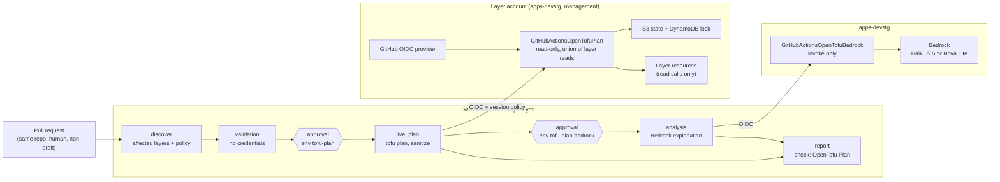
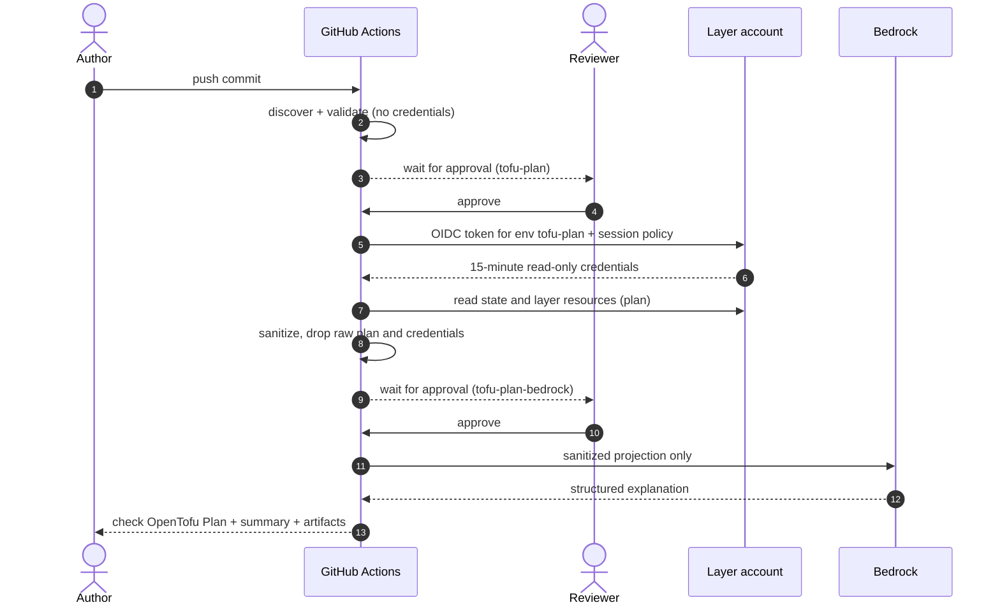

# OpenTofu pull-request plan

A GitHub Actions check that validates and plans OpenTofu changes on pull requests, with an
optional Bedrock explanation. It never applies anything.

- Workflow: [`.github/workflows/tofu-plan.yml`](../../.github/workflows/tofu-plan.yml)
- Code: [`@bin/scripts/tofu_plan_ci/`](../../@bin/scripts/tofu_plan_ci/)
- AWS identities: [`apps-devstg/global/github-oidc-tofu-plan`](../../apps-devstg/global/github-oidc-tofu-plan/),
  [`management/global/github-oidc-tofu-plan`](../../management/global/github-oidc-tofu-plan/)
- History, gates, and decisions: [`tofu-plan-history.md`](tofu-plan-history.md)

## 1. What it is

For a PR that touches one allowlisted layer, the workflow:

1. validates the layer without credentials;
2. after a reviewer approves, runs a read-only `tofu plan` against the real state;
3. after a second approval, asks Bedrock to explain the plan;
4. publishes a sanitized summary and the `OpenTofu Plan` check.

Steps 2 and 3 are skipped for PRs that touch more layers than the limit or change the workflow,
providers, backends, or configuration (see [Limitations](#limitations)).

Status (2026-10-12): **active** on two layers, `apps-devstg/global/cli-test-layer` (test layer)
and `management/global/sso`. The check is not required.

## 2. Purpose

**Problem.** Reviewers judged infrastructure PRs by reading HCL, and the plan was generated
locally by the author and pasted by hand, which leaks identifiers easily and can go stale against
later commits.

**What it gives maintainers:**

- a plan for every commit, generated in CI from real state, not from the author's machine;
- a summary of actions per resource (create, update, delete, replace) and drift, with no values,
  so it is safe to keep in a public repository;
- an advisory explanation of risk and review questions;
- no new infrastructure to run: no Atlantis server, GitHub App, or webhook.

**Deliberately out of scope:** apply, destroy, import, any state change, PR comments, fork and
bot PRs, and planning layers outside the allowlist. Applying stays a manual maintainer step.

## 3. Using it

**PR author.** Open a non-draft PR from a branch in this repository. Nothing else is needed.

**Reviewer approving `tofu-plan`.** Approval runs the PR's exact commit with read access to that
layer's state and resources. Approve only after reading the diff: provider code, data sources, and
modules in the PR execute during the plan.

**Reviewer approving `tofu-plan-bedrock`.** Approval sends the sanitized summary to the model.
Reject it when no explanation is needed; the check still completes.

**Reading the result.** Open the run's summary, or the artifacts:

| Artifact | Contents |
| --- | --- |
| `tofu-plan-layer-<layer>` | `summary.md` (actions table), `result.json` (status, counts), `review.json` (per-resource actions and changed attribute names, drift, check counts) |
| `tofu-plan-llm` | `analysis.md` / `analysis.json`: risk level, summary, risks, reviewer questions |
| `tofu-plan-validation-<layer>`, `tofu-plan-discovery` | Credential-free validation and layer discovery |

Artifacts are kept for 7 days. The summary shows *which* attributes change, never their values.
For the values, use the author's local plan in the PR description: only the action section,
redacted and scanned with `@bin/scripts/redact_plan.py`, never a raw plan, saved plan file, or
`tofu show -json` output (procedure in [`CLAUDE.md`](../../CLAUDE.md#standard-workflow-posting-a-tofu-plan-to-a-pr-for-review)).

## 4. Architecture

### Diagram



### Components

| Component | Role |
| --- | --- |
| `discover` job | Maps changed files to layers (nearest `config.tf`), keeps only allowlisted active layers, and decides whether a live plan is allowed. Also runs the package's unit tests. |
| `validation` job | `tofu init -backend=false -lockfile=readonly` and `tofu validate` per layer. No credentials, no environment. |
| `live_plan` job | Environment `tofu-plan`. Assumes the account's plan role, runs `init`, `plan`, and `tofu show -json`, and keeps only the sanitized projection. |
| `analysis` job | Environment `tofu-plan-bedrock`. Sends the projection to Bedrock with a separate role; the model must answer through a forced, schema-bound tool call, which is validated. Advisory only. |
| `report` job (`OpenTofu Plan`) | Aggregates all results into the stable check and the run summary. |
| `tofu_plan_ci` package | `discover.py` (layers), `policy.py` (live-plan eligibility), `plan_identity.py` (role and session policy), `plan_report.py` (sanitization), `bedrock_analysis.py`, `aggregate.py`, and `workflow.py` (one command per job). |
| `<account>/global/github-oidc-tofu-plan` | One per account with allowlisted layers: OIDC provider, plan role, and its policy, built from a `plan_targets` map plus one `plan-target-<layer>.tf` per layer. apps-devstg also holds the Bedrock role. |
| Environments `tofu-plan`, `tofu-plan-bedrock` | Required reviewer, Prevent self-review, no admin bypass. `tofu-plan` holds the `TOFU_PLAN_COMMON_TFVARS` secret; `tofu-plan-bedrock` sets `BEDROCK_MODEL_ID`. |

### Interactions: one PR



A new commit cancels the in-progress run for that PR. Typical runner time is about 2 minutes per
layer; the rest is waiting for approvals.

### Key design points

- **Trust is bound to the environment.** Each role accepts only a GitHub token issued for its own
  environment (`repo:binbashar/le-tf-infra-aws:environment:tofu-plan` or `...:tofu-plan-bedrock`),
  plus the repository and organization IDs and a PR merge ref or `master`. Approval is therefore
  required to get credentials, even if a PR edits the workflow.
- **Least privilege per layer.** The plan role holds the union of its layers' reads, derived from
  CloudTrail. Each job adds an inline session policy that narrows the state bucket and lock table
  to its own layer, so a plan of one layer cannot read another layer's state. State writes are
  explicitly denied.
- **Trusted tooling.** Sanitization, role resolution, and the Bedrock client run from the PR's
  base revision, not from the PR.
- **Control-plane changes never get credentials.** A PR that changes the workflow, its package,
  CODEOWNERS, provider locks, `config.tf`, `config/`, `<account>/config/`, JSON configuration,
  providers, backends, module or provider sources, external data sources, provisioners, or
  `null_resource`/`terraform_data` runs validation only.
- **Sanitized contract.** Persisted output has resource addresses (instance keys replaced),
  action classes, changed attribute names, drift, and counts. It never has values, variables,
  state, or the binary plan; account IDs, ARNs, and credential shapes are redacted.
- **The model cannot change the result.** The check depends only on the deterministic plan.

### Limitations

| Limitation | Consequence |
| --- | --- |
| Allowlist plus `TOFU_PLAN_MAX_LAYERS=1` | A PR touching two allowlisted layers plans neither; split it. |
| Layer fit | Only layers with a single `aws` provider for their own account and no cross-account remote state. |
| Control-plane changes are validation-only | Lock, provider, or backend changes are never planned live; plan them locally. |
| No values in the report | Reviewers and the model see *what* changes, not *how*; the explanation's questions are generic. |
| Approval per run | An unapproved run keeps the check pending until GitHub cancels it after 30 days. |
| Manual dispatch works only from `master` | The role trusts PR merge refs and `master`, not feature branches. |
| Variables are read at run start | Changing a variable does not affect a run already started. |
| Delete and replace only warn | They are reported as high-severity signals but do not fail the check. |

### Estimated cost

| Item | Cost |
| --- | --- |
| GitHub Actions | Free: public repository on standard runners (about 2 runner-minutes per layer per commit). |
| AWS STS, IAM, S3 and DynamoDB reads | Effectively $0 (a few requests per run). |
| Bedrock, Claude Haiku 5.5 | About **$0.0006 per explanation** (measured on #1228: ~1.4K input, ~0.9K output tokens at $0.10 / $0.50 per million, Anthropic list price billed through AWS Marketplace); at most ~$0.002 (output capped at 2,400 tokens). |
| Bedrock, Nova Lite | About **$0.0001 per explanation** (measured: ~1K input, ~0.2K output tokens at $0.06 / $0.24 per million); at most ~$0.0012. |

At 100 explained commits a month: under $0.10 with either model.

## 5. Security

**Threat model.** A PR author can change OpenTofu configuration, modules, and the workflow
itself. Anything that runs during a credentialed plan can read what the role can read.

| Control | Protects against |
| --- | --- |
| Same-repo, human, non-draft PRs only | Forks and bots never start a job; creating a branch requires write access. |
| Environment approval + environment-bound trust | Credentials without a human decision on that exact commit. |
| Validation-only for control-plane changes | A PR changing the workflow, providers, or backends getting credentials. |
| Base-revision tooling | A PR altering sanitization or the Bedrock client in its own run. |
| Session policy per layer, explicit state-write deny | Reading other layers' state; persisting refreshed state. |
| 15-minute sessions, account check, masked IDs, temporary files removed | Credential reuse and leaks through logs. |
| Full-SHA Action pins, hash-locked Bedrock client, CODEOWNERS | Supply-chain changes going unreviewed. |

**Residual risk.** The workflow runs on `pull_request`, so its YAML comes from the PR. The
environment reviewer is authorizing execution of that commit; approval is not a formality.

**Data the roles can read beyond what the report shows:**

| Layer | Readable data |
| --- | --- |
| `apps-devstg/global/cli-test-layer` | The test IAM role and policy. |
| `management/global/sso` | Identity Center users (names, e-mail addresses), groups, memberships, permission sets, and assignments. Accepted by the maintainer on 2026-10-11. |

## 6. Operations

### Configuration

| Kind | Name | Value / purpose |
| --- | --- | --- |
| Variable | `TOFU_PLAN_LIVE` | `true`. Kill switch for live plans. |
| Variable | `TOFU_PLAN_LLM` | `true`. Kill switch for the Bedrock explanation. |
| Variable | `TOFU_PLAN_LAYERS` | Allowlist, comma- or newline-separated. |
| Variable | `TOFU_PLAN_MAX_LAYERS` | `1`. Above it, no layer is planned. |
| Variable | `TOFU_PLAN_ROLES` | JSON: account directory → `{role_arn, account_id}`. A missing account fails closed. |
| Variable | `AWS_TOFU_PLAN_BEDROCK_ROLE_ARN`, `AWS_TOFU_PLAN_BEDROCK_ACCOUNT_ID` | Bedrock role and its account. |
| Variable | `OPENTOFU_VERSION`, `AWS_REGION` | Default `1.9.1`, `us-east-1`. |
| `tofu-plan` secret | `TOFU_PLAN_COMMON_TFVARS` | Copy of the ignored `config/common.tfvars`; written `0600` and removed after the plan. |
| `tofu-plan-bedrock` variable | `BEDROCK_MODEL_ID` | `us.anthropic.claude-haiku-5-5` or `amazon.nova-lite-v1:0`, the only two IDs the role and the analyzer accept. Without it, the job uses Haiku 5.5. Keep it on the environment: `claude.yml` reads the repository variable of the same name. |

### Kill switches

Set `TOFU_PLAN_LIVE` or `TOFU_PLAN_LLM` to `false` to stop that stage for every PR, for example
during an incident, a suspected role problem, or bad model output. Runs started afterwards skip
it; the rest of the check keeps working.

### Re-running

- Push a new commit, or close and reopen the PR (picks up changed variables).
- Manual dispatch: `gh workflow run tofu-plan.yml --ref master -f layer=<layer>`. Only from
  `master`; a feature branch fails at `AssumeRoleWithWebIdentity` by design.

### Adding a layer

Each layer grants approved PR code read access to its state and resources, so each is its own
reviewed change:

1. **Check fit.** Single `aws` provider for the layer's own account, no cross-account remote state,
   no external data sources, and a lock file with `linux_amd64` hashes: validate in a
   `linux/amd64` OpenTofu container, or run `tofu providers lock` for linux and darwin, amd64 and
   arm64. macOS cannot detect a missing hash.
2. **Derive the reads.** Run `leverage tofu plan` on the converged layer and list the session's
   CloudTrail management events about 15 minutes later. State and lock access are already granted
   per `plan_targets` entry. When the service authorization reference lists several resource
   types for an action (for example `sso:ListTagsForResource`), grant it on each type the layer
   manages; CloudTrail shows only the action.
3. **Extend the account's identity layer.** Add a `plan_targets` entry and a
   `plan-target-<layer>.tf` scoped to the narrowest ARNs. A new account needs its own
   `github-oidc-tofu-plan` layer; check first for an existing GitHub OIDC provider (one per
   account).
4. **Simulate.** `iam simulate-custom-policy` against real ARNs (allowed) and against writes and
   other layers' state (denied), with the job's session policy as the permissions boundary.
5. **Apply and configure.** A maintainer applies the identity layer; add the account to
   `TOFU_PLAN_ROLES` and the layer to `TOFU_PLAN_LAYERS`.
6. **Supervised plan.** Dispatch the layer from `master`, approve, and inspect the artifacts. On
   `AccessDenied`, add only the denied read.
7. **Record data exposure** in [Security](#5-security) and get the risk accepted.

### Troubleshooting

| Symptom | Cause | Fix |
| --- | --- | --- |
| Validation fails in CI but passes locally | Lock file lacks the `linux_amd64` `h1:` hash; `validate` rejects the provider | Regenerate the lock for four platforms. |
| Live plan fails with `Denied AWS action: X` in `summary.md` | The plan role lacks a read | Add exactly that action, on the resource types the layer manages. |
| Live plan skipped on a PR | Control-plane change, layer not allowlisted, more than `TOFU_PLAN_MAX_LAYERS` layers, or `TOFU_PLAN_LIVE=false` | See `discovery.md`. Plan control-plane changes locally. |
| Bedrock job skipped | `TOFU_PLAN_LLM` was `false` when the run started, or the live plan did not succeed | Re-run after fixing. |
| `Not authorized to perform sts:AssumeRoleWithWebIdentity` | Dispatch from a feature branch, or wrong environment | Dispatch from `master`, or use the PR. |
| Check stays pending | Nobody approved the environment | Approve or reject the deployment. |

### Local verification

```bash
PYTHONPATH=@bin/scripts python3 -m unittest discover -s @bin/scripts/tofu_plan_ci/tests -v
actionlint .github/workflows/tofu-plan.yml
```

The Bedrock client is the only third-party dependency, pinned with hashes in
[`requirements.txt`](../../@bin/scripts/tofu_plan_ci/requirements.txt) (edit
[`requirements.in`](../../@bin/scripts/tofu_plan_ci/requirements.in) and recompile).

## 7. Roadmap

| Item | Status |
| --- | --- |
| Credential-free validation, protected live plan, Bedrock explanation | Done (POC, promoted 2026-10-11) |
| Per-account roles and per-layer session policy; `management/global/sso` onboarded | Done (2026-10-11) |
| Active by default; variables as kill switches | Done (2026-10-12) |
| Models: Claude Haiku 5.5 and Nova Lite, switchable per environment; Sonnet 4.6 removed | Done (2026-10-12). On #1228 Haiku gave a far more specific explanation (5 s vs 2 s) |
| Destructive-change policy: should delete/replace warn or fail the check | Open |
| Make `OpenTofu Plan` a required check | Blocked by the two items above, plus an incident and credential-revocation procedure |
| More layers | On demand, through [Adding a layer](#adding-a-layer) |
| Planning more than one layer per PR (`TOFU_PLAN_MAX_LAYERS` > 1) | Not planned; needs a review of approval and cost per run |
| External contributors (fork PRs) | Out of scope; would need a separate design |
